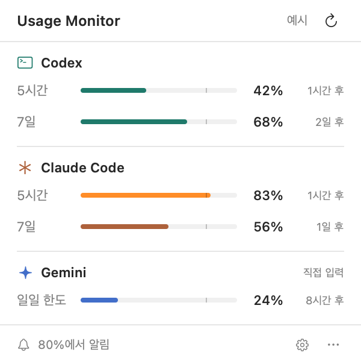

<div align="center">

# Usage Monitor

**다음 작업 전에, AI 사용 한도를 한눈에.**

Codex · Claude Code · Gemini를 위한 작은 macOS 메뉴 막대 앱


[설치](#설치) · [서비스 연결](#서비스-연결) · [알림](#알림) · [개발](#개발) · [문제 해결](#문제-해결)



<sub>앱의 SwiftUI 화면을 예시 데이터로 렌더링한 이미지입니다. 실제 계정 사용량이 아닙니다.</sub>

</div>

## 무엇을 할 수 있나요?

- **클릭 한 번으로 확인** — 메뉴 막대 아이콘을 눌러 AI별 사용량을 확인합니다.
- **간단한 그래프** — 사용률, 알림 기준선, 한도 리셋까지 남은 시간을 표시합니다.
- **원하는 AI만 표시** — Codex, Claude Code, Gemini를 각각 켜고 끌 수 있습니다.
- **두 가지 알림 방식** — 80% 같은 지정 비율에 도달했을 때, 또는 10%, 20%, 30%처럼 일정 비율을 사용할 때마다 알립니다.
- **중복 없는 알림** — 각 도달 구간은 한 번만 알리며, 여러 구간을 건너뛰면 가장 높은 구간 하나만 알립니다. 앱을 다시 열어도 기록을 유지합니다.
- **화면에 맞는 패널** — 현재 모니터에 맞춰 높이를 제한하고, 긴 목록은 제목·설정 버튼을 남겨 두고 스크롤합니다.
- **불확실한 값은 구분** — 연결 대기, 오래된 값, 조회 실패, 리셋 이후 대기 상태를 표시합니다.

> **현재는 첫 번째 MVP입니다.** Codex는 자동 조회, Claude Code는 상태 표시줄 연결, Gemini는 직접 입력을 지원합니다. Gemini 자동 조회와 설치용 DMG 배포는 아직 지원하지 않습니다.

## 지원 범위

| 서비스 | 연결 방식 | 갱신 | 참고 |
| :--- | :--- | :--- | :--- |
| **Codex** | 로컬 Codex CLI의 공식 App Server | 5분마다, 또는 새로고침 | ChatGPT 계정 로그인 필요. 서비스가 반환하는 여러 한도 구간을 표시 |
| **Claude Code** | 공식 status line의 `rate_limits` 데이터 | Claude 응답 이후, 앱에서 30초마다 확인 | 해당 데이터를 제공하는 계정·CLI 버전 필요. 5시간·7일·지출 한도를 제공되는 만큼 표시 |
| **Gemini** | `/stats model`로 확인한 사용률 직접 입력 | 저장할 때만 | 한 번에 한 한도를 기록. 자동 조회나 모델별 통합 추정은 하지 않음 |

토큰 수나 컨텍스트 사용률을 구독 한도 비율로 바꾸지 않습니다. 제공되지 않은 한도는 0%로 표시하지 않습니다.

## 설치

### 준비물

- macOS 13 Ventura 이상
- Swift 5.9 이상을 포함한 Xcode Command Line Tools 또는 Xcode
- Codex 자동 조회를 이용하려면 로그인된 Codex CLI

터미널에서 개발 도구를 설치하고 버전을 확인합니다. 설치 창이 나타나면 설치를 완료한 뒤 진행하세요.

```bash
xcode-select --install
swift --version
```

이미 Command Line Tools가 설치되어 있다면 첫 명령은 건너뛰어도 됩니다.

### 소스에서 앱 만들기

```bash
git clone https://github.com/chlee1252/usage-limit-monitor.git
cd usage-limit-monitor
./scripts/build-app.sh
open "dist/Usage Monitor.app"
```

빌드 결과는 `dist/Usage Monitor.app`에 생성됩니다. 현재 Mac의 아키텍처로 빌드하며 외부 패키지는 내려받지 않습니다.

**계속 사용할 경우**, 앱을 종료하고 Finder에서 `dist/Usage Monitor.app`을 `응용 프로그램`으로 옮긴 다음 실행하세요. Claude 연결은 앱을 최종 위치로 옮긴 뒤 설정하는 것이 좋습니다.

앱은 Dock에 표시되지 않습니다. **화면 상단 메뉴 막대의 막대그래프 아이콘**을 찾으세요. 표시되는 숫자는 선택한 서비스 중 유효한 최신 데이터의 가장 높은 사용률이며, 서비스별 사용량을 합산한 값은 아닙니다.

빌드 스크립트는 로컬 실행용 ad-hoc 서명을 적용합니다. Developer ID 서명·Apple 공증을 거친 배포본은 아닙니다.

### 로그인 시 자동 실행

앱을 응용 프로그램 폴더로 옮긴 뒤 macOS **시스템 설정 → 일반 → 로그인 항목**에서 Usage Monitor를 추가하세요. 앱 자체의 자동 실행 스위치는 아직 없습니다.

### 업데이트

Usage Monitor를 종료하고 다음 명령을 실행합니다.

```bash
git pull --ff-only
./scripts/build-app.sh
```

기존 앱을 새 빌드로 교체해 주세요. 앱의 위치가 달라졌다면 Claude 연결을 해제한 뒤 다시 연결하세요.

## 서비스 연결

### Codex

1. Codex CLI에서 ChatGPT 계정으로 로그인합니다.
2. Usage Monitor 패널 하단의 설정 버튼을 누릅니다.
3. **Codex · 자동 조회**에서 실행 파일 경로를 확인합니다.
4. **지금 조회**를 누릅니다.

앱은 `/opt/homebrew/bin/codex`, `/usr/local/bin/codex`, `~/.local/bin/codex`를 자동 탐색합니다. 다른 위치에 설치했다면 터미널에서 `command -v codex`로 확인하고 설정에 경로를 입력하거나 **선택…**을 사용하세요.

기존 Codex 인증을 사용하는 `account/rateLimits/read` 요청만 보냅니다. 모델에게 프롬프트를 보내지 않습니다. API 키 전용 계정은 ChatGPT 구독 한도를 제공하지 않을 수 있습니다.

### Claude Code

1. 앱을 계속 사용할 위치로 옮깁니다.
2. 설정에서 **Claude 연결**을 누릅니다.
3. Claude Code에서 응답을 한 번 받습니다.
4. 최대 30초 후 패널을 확인합니다.

연결 버튼은 `~/.claude/settings.json`의 `statusLine`에 작은 로컬 스크립트를 연결합니다. 기존 상태 표시줄 명령은 계속 실행하며, 기존 설정을 백업합니다. **연결 해제**를 누르면 이전 상태 표시줄로 복원합니다. 다른 Claude 설정은 유지합니다.

Claude Code에서 `rate_limits`를 제공해야 합니다. 한도가 없는 계정이나 구버전에서는 연결해도 값이 표시되지 않을 수 있습니다. 앱을 켜 두어도 Claude가 새 데이터를 보내지 않으면 값은 갱신되지 않습니다.

`CLAUDE_CONFIG_DIR`를 사용하는 경우 앱 프로세스에도 같은 환경 변수가 전달되어야 합니다. Finder에서 실행한 앱은 터미널의 환경 변수를 자동으로 상속하지 않습니다. 사용자 지정 설정 폴더가 필요하면 다음처럼 실행하세요.

```bash
CLAUDE_CONFIG_DIR="/your/claude/config" "/Applications/Usage Monitor.app/Contents/MacOS/UsageMonitor"
```

### Gemini

1. Gemini CLI에서 `/stats model`로 한도를 확인합니다.
2. 앱 설정의 **Gemini · 직접 입력**에서 **사용한 비율**과 리셋 시간을 입력합니다.
3. **사용량 저장**을 누릅니다.

남은 비율이 30%라면 사용률은 70%입니다. 모델별로 한도가 다를 수 있으므로 확인하려는 한도 하나를 기준으로 입력하세요. 입력한 값은 **자동으로 변하지 않습니다**. 저장 시 알림 기준을 넘었다면 알림을 받을 수 있지만, 이후 사용량 증가를 자동 감지하지는 못합니다.

## 알림

1. 설정에서 **사용량 알림 받기**를 켭니다.
2. macOS 알림 권한을 허용합니다.
3. **알림 방식**에서 **지정 비율 도달 시** 또는 **일정 비율마다**를 선택합니다.
4. **테스트 알림**으로 표시 여부를 확인합니다.

| 방식 | 설정 | 예시 |
| :--- | :--- | :--- |
| 지정 비율 도달 시 | 10~100%, 5% 단위 (기본 80%) | 80%를 설정하면 80% 이상을 처음 확인할 때 한 번 알림 |
| 일정 비율마다 | 5%, 10%, 20%, 25%, 50% 간격 | 10%를 설정하면 10%, 20%, 30%…100%에서 각각 알림 |

알림은 앱이 실행 중일 때, 사용량을 확인한 시점에 동작합니다. 15분 이상 지난 데이터와 리셋 시간이 지난 한도는 알림에서 제외합니다. 설정 변경은 다음 사용량 확인부터 적용되며, 새로고침으로 바로 확인할 수 있습니다.

처음 연결할 때 이미 83%를 사용했다면, 10% 간격 모드는 **80% 구간 도달 알림 하나**만 보냅니다. 조회 사이에 21%에서 43%로 증가해도 **40% 알림 하나**로 합칩니다. 같은 구간은 사용률이 잠시 내려갔다가 올라와도 반복하지 않으며, 한도의 리셋 시각이 바뀌면 다시 알립니다. 서비스와 한도 구간별로 별도로 기록합니다. 방식·기준·간격을 바꾸면 새 설정에 대한 알림이 발생할 수 있습니다.

알림을 허용했는데 배너가 보이지 않으면 macOS 알림 설정과 집중 모드를 확인하세요. 잠자기 중에는 실시간 감지하지 않습니다. 리셋 시간이 제공되지 않는 한도는 같은 설정의 각 도달 구간을 한 번만 알립니다.

## 데이터와 개인정보

- 별도의 계정, 앱 서버, 분석 SDK가 없습니다.
- Codex는 설치된 CLI를 통해 서비스에 사용량을 조회합니다. CLI 자체의 네트워크·인증 정책은 그대로 적용됩니다.
- 앱은 API 키·OAuth 토큰을 직접 읽거나 별도로 저장하지 않습니다.
- Claude 상태 표시줄 입력에서 **한도 비율과 리셋 시각만** 추려 저장합니다. 대화 내용·작업 경로·세션 ID는 저장하지 않습니다.
- 설정, 사용량 스냅샷, 알림 기록은 아래 폴더에 저장됩니다.

```text
~/Library/Application Support/UsageMonitor/
```

### 삭제

먼저 설정에서 **Claude 연결 해제**를 누른 뒤 앱을 종료하고 삭제하세요. 앱 데이터까지 지우려면 Finder의 **이동 → 폴더로 이동**에서 위 폴더를 열어 삭제합니다. 로그인 항목에 추가했다면 그 항목도 제거하세요.

## 개발

```bash
swift build
swift test
./scripts/build-app.sh
```

알림 테스트와 일반 실행에는 `.app` 번들을 사용하세요. 앱 번들 정보가 없는 `swift run`은 일반 실행 경로로 지원하지 않습니다.

개발용 명령:

```bash
# 실제 계정의 Codex 한도 조회 (모델 호출 없음)
.build/debug/UsageMonitor --check-codex

# 예시 데이터로 README 화면 이미지 생성
.build/debug/UsageMonitor --render-preview docs/preview.png
```

`--check-codex` 출력과 캐시 파일의 날짜는 Swift Codable의 기본 Date 인코딩(2001-01-01 기준 초)입니다. 서비스 응답의 Unix epoch는 파싱 단계에서 변환합니다.

```text
Sources/
├── UsageCore/              # 한도 파서, Codex RPC, 저장, Claude 연결, 알림 판단
└── UsageMonitor/           # 메뉴 막대 앱, SwiftUI 패널, 설정, macOS 알림
Tests/UsageCoreTests/       # 데이터 검증, 알림 중복·리셋, RPC 타임아웃, 설정 복원
scripts/build-app.sh        # 릴리스 빌드 + .app 패키징 + 로컬 서명
docs/                      # 화면 이미지, 디자인 메모
```

테스트는 한도 데이터 누락·잘못된 값, 여러 Codex 한도, 컨텍스트/한도 구분, 오래된 값·리셋·중복 알림, Claude 설정 보존·복원, RPC 응답과 타임아웃을 검증합니다. 실제 알림 배너와 서비스별 계정 호환성은 실행 환경에서 별도 확인이 필요합니다.

## 문제 해결

| 증상 | 확인할 내용 |
| :--- | :--- |
| 앱 창이 보이지 않음 | 메뉴 막대 앱입니다. 상단 막대그래프 아이콘을 클릭하세요. |
| Codex CLI를 찾지 못함 | `command -v codex`로 확인한 실행 파일 경로를 설정에 입력하세요. |
| Codex 조회 실패 | CLI 로그인, 네트워크, CLI 버전을 확인하세요. ChatGPT 계정이 필요합니다. |
| Claude 연결 후 값 없음 | Claude에서 응답을 한 번 받은 뒤 기다려 주세요. CLI가 `rate_limits`를 제공해야 합니다. |
| 앱을 옮긴 뒤 Claude 연결 중단 | 연결을 해제하고 새 위치에서 다시 연결하세요. |
| 오래된 값 표시 | 마지막 확인 후 15분이 지났습니다. Codex는 새로고침, Claude는 새 응답, Gemini는 직접 입력이 필요합니다. |
| 리셋 이후에도 값이 갱신되지 않음 | 앱은 사용률을 임의로 0%로 바꾸지 않습니다. 서비스의 새 데이터가 필요합니다. |
| 알림이 안 옴 | 앱 실행 여부, 알림 권한, 집중 모드, 이미 발송한 한도인지 확인하세요. |

## 다음 단계

- Gemini 자동 한도 조회 어댑터
- 로그인 시 실행 설정
- 사용량 히스토리와 추세 그래프
- 서명·공증된 배포본 및 자동 업데이트
- 여러 계정과 프로필 선택

## 공식 자료

- [Codex App Server — 계정 및 한도 조회](https://developers.openai.com/codex/app-server/)
- [Claude Code — 상태 표시줄과 rate_limits](https://code.claude.com/docs/en/statusline)
- [Gemini CLI — 명령어 안내](https://geminicli.com/docs/reference/commands/)

이 프로젝트는 OpenAI, Anthropic, Google의 공식 앱이 아닙니다.
